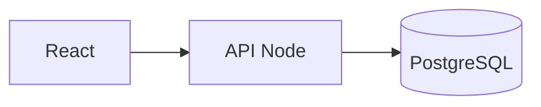

# Vision Patrimoine

Suivi **patrimonial immobilier** : biens, prêts, SCI, cash-flow et rendements.

Les calculs couvrent la mensualité, le capital restant dû, les intérêts, les charges et la plus-value. Aucun dossier client n'est stocké dans ce dépôt.

<p align="center">
  
  
  
  
  
</p>

<p align="center">
  <strong>Dépôt :</strong> <a href="https://github.com/Meriem1403/Vision">github.com/Meriem1403/Vision</a>
</p>

---

## Sommaire

- [Présentation](#présentation)
- [Fonctionnalités](#fonctionnalités)
- [Stack technique](#stack-technique)
- [Architecture](#architecture)
- [Prérequis](#prérequis)
- [Installation](#installation)
- [Déploiement](#déploiement)
- [Sécurité](#sécurité)
- [Structure du projet](#structure-du-projet)
- [Scripts disponibles](#scripts-disponibles)

---

## Présentation

Vision Patrimoine suit un parc : chaque bien a ses prêts, ses associés, sa banque et son dossier. Les indicateurs (cash-flow, capital restant, évolution du patrimoine) sont calculés à partir des champs saisis, avec la formule affichée à côté du chiffre. L'import de pièces PDF alimente un dossier, sans déposer ces pièces dans Git.

---

## Fonctionnalités

| Module | Description |
|--------|-------------|
| **Biens** | Fiche, détail, filtres |
| **Prêts** | Mensualité, capital, intérêts |
| **SCI et associés** | Entités et quotes-parts |
| **Banques** | Dossier bancaire et portail |
| **Graphiques** | Évolution du patrimoine |
| **PDF** | Aperçu et import de pièces |
| **Comptes** | Connexion et administration des utilisateurs |
| **Adresses** | Autocomplétion d'adresse |

---

## Stack technique

| Couche | Technologies |
|--------|----------------|
| Frontend | React, Vite, TypeScript, Tailwind CSS, Radix UI |
| API | Node.js, TypeScript (`backend/`) |
| Données | PostgreSQL, dossier `supabase/` pour le schéma |
| Calculs | Bibliothèque dans `src/lib` (prêts, dates de bail, associés) |
| Conteneurisation | Docker Compose |
| Frontend statique | Netlify (`npm run build`, dossier `dist`) |

Le guide de mise en ligne est [DEPLOY.md](./DEPLOY.md).

---

## Architecture



Les formules affichées dans l'interface sont les mêmes que celles de l'API : un chiffre à l'écran se retrouve dans le calcul.

---

## Prérequis

- **Docker** et Docker Compose
- **Node.js** 20 si le frontend est lancé hors Docker
- **Git**

---

## Installation

```bash
git clone https://github.com/Meriem1403/Vision.git
cd Vision
docker compose up --build
```

Hors Docker : `npm install` puis `npm run dev` pour le frontend, et l'API dans `backend/`. Les ports sont ceux de `docker-compose.yml`.

`npm run docker:up` et `npm run docker:down` relaient le compose.

---

## Déploiement

| Cible | Fichier |
|-------|---------|
| Local | `docker-compose.yml` |
| Netlify | `netlify.toml` |
| Guide | [DEPLOY.md](./DEPLOY.md) |

La base de production ne se reconstruit pas depuis un seed du dépôt : les dossiers réels restent chez l'exploitant.

---

## Sécurité

- Aucune adresse de bien, aucun tableau d'amortissement client, aucun export bancaire dans Git.
- Secrets de base et JWT dans l'environnement local, pas dans un fichier commité.
- Le dossier `private/` ne doit pas recevoir de pièce réelle.

---

## Structure du projet

```
Vision/
├── src/app/components/     # Biens, prêts, SCI, graphiques
├── src/lib/                # Calculs et client API
├── backend/src/routes/     # auth, biens, prêts, dossiers, entités
├── supabase/
├── docker-compose.yml
└── DEPLOY.md
```

---

## Scripts disponibles

| Commande | Description |
|----------|-------------|
| `npm run dev` | Frontend Vite |
| `npm run build` | Build de production |
| `npm run docker:up` | Démarre le compose |
| `npm run docker:down` | Arrête le compose |

---

<p align="center">
  <sub>Vision Patrimoine — biens, prêts et cash-flow. Aucun dossier client dans le dépôt.</sub>
</p>
